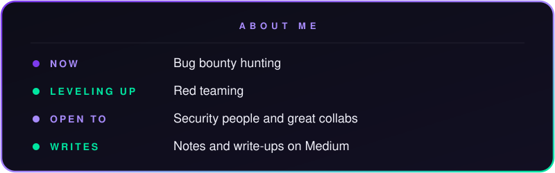

 

**I break things politely, so they can be fixed properly.**

 

 

 

## `{ my area }`

 

C &nbsp;&middot;&nbsp; Python &nbsp;&middot;&nbsp; Security tools &nbsp;&middot;&nbsp; AWS

 

## `{ say hi }`

  

<h2 align="center"><i>The most effective way to do it, is to do it.</i></h2>

 

